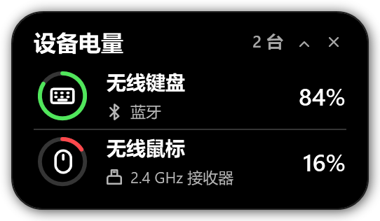
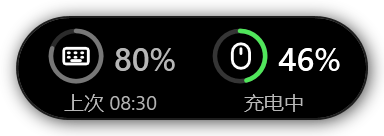

# PeriphGauge · 外设电量

在 Windows 任务栏或桌面上的黑色胶囊里查看无线键盘、鼠标和耳机的电量。点开胶囊即可看到每台设备的名称、电量和连接方式。

<p>
  
  
  
</p>

## 下载与使用

1. 下载 [PeriphGauge-win-x64.exe](https://github.com/aliealielie/PeriphGauge/releases/latest/download/PeriphGauge-win-x64.exe)，双击运行。便携版已包含 .NET 运行时，使用普通用户权限即可。
2. 托盘数字显示本次读到的最低电量。鼠标悬停可查看设备与连接方式，点击图标可展开完整面板。如果图标在任务栏的 `^` 菜单里，可以将它拖到时钟旁。
3. 电量每分钟刷新一次，电脑唤醒或解锁后也会立即刷新。看到「—」、灰色的「上次」读数或「读取失败」时，点开胶囊或从侧边展开即可重新读取。面板和托盘菜单都可以手动刷新。关闭面板后程序继续在托盘运行，右键托盘图标可退出。


上图均为使用示例数据的程序界面。设计稿见[悬浮窗](docs/island-design.png)和[托盘面板](docs/panel-design.png)。

## 桌面悬浮窗与启动选项

打开面板右上角的「更多选项」，或右键点击托盘图标，即可使用以下功能。

- 勾选 **显示桌面悬浮窗** 后，胶囊最多显示两台设备，优先显示键盘和鼠标。白色图标外的圆环表示剩余电量，20% 及以下用红色，超过 20% 用绿色。灰色空环和「—」表示设备尚未上报电量。
- 点击胶囊查看所有设备和连接方式，点向上箭头收起。拖动可调整位置。勾选 **悬浮窗置顶** 后，胶囊会显示在普通窗口上方。
- 将胶囊或展开的悬浮窗拖到屏幕左边或右边，松手后只留一个黑色小把手。也可以点击展开面板顶部的 **收到侧边** 按钮，停靠到较近的一侧。点击把手上的箭头即可恢复。重新启动程序后，悬浮窗会记住停靠的边和高度。
- 勾选 **开机自启动** 后，程序会在登录 Windows 时进入托盘。上次已开启的悬浮窗会恢复到原来的位置，并沿用置顶和展开设置。若想在登录后自己打开悬浮窗，取消勾选「显示桌面悬浮窗」即可。
- **低电量提醒** 默认开启。设备已确认的电量从高于 20% 降到 20% 或以下时，程序会发送一次 Windows 通知。在持续跟踪这台设备期间，电量要先恢复到 25% 或以上，再降到 20% 或以下，才会再次提醒。首次读到低电量和历史读数都不会触发通知。开关会记住你的选择。
- 点击 **创建桌面快捷方式**，即可通过桌面上的「外设电量」图标打开面板。

快捷方式指向当前便携版文件。移动 EXE 后，可在新位置重新创建桌面快捷方式，并重新启用自启动。

## 设备兼容性

| 连接方式 | 如何读取电量 |
| --- | --- |
| 蓝牙 | 读取 Windows 提供的电量属性，支持标准 BLE 电量服务。是否显示百分比取决于设备上报。 |
| 2.4 GHz 接收器 | 已实测迈从 A5（`2023:F013`）和 K99 所用的 Compx 接收器（`05AC:024F`）。A5 明确上报正在充电时显示「充电中」。Compx 接收器不同固件的充电标记含义不同，目前只显示电量。部分其他接收器可被发现，能否读取电量取决于其协议。 |

同一设备的电量一次变化达到 10 个百分点时，程序只复读这台设备，其他设备先显示本轮读数。两次新读数相差不超过 2 个百分点，或复读值回到原电量附近时，界面采用复读值。其余情况保留上次确认的读数，并标出时间。

设备仍能识别但暂时读不到电量时，界面用灰色显示最近 10 分钟内确认过的电量，标明「上次」和读取时间。Windows 蓝牙查询超时或失败时，暂时找不到的蓝牙设备也沿用这条规则。完整扫描确认设备离线后即移除，退出程序会清空历史。设备在线且没有近期读数时显示「—」。目前提供 Windows 11 x64 便携版。



程序在本机读取设备信息和电量，无联网依赖。

## 从源码构建

在 Windows 上安装 .NET 10 SDK，在仓库目录运行：

```powershell
dotnet run --project PeriphGauge.csproj
dotnet publish PeriphGauge.csproj -c Release -r win-x64 --self-contained -p:PublishSingleFile=true -p:IncludeNativeLibrariesForSelfExtract=true -p:EnableCompressionInSingleFile=true -p:DebugType=none -o release
```

把 `release/PeriphGauge.exe` 改名为 `PeriphGauge-win-x64.exe` 即为发布文件。传入 `--preview` 可打开带示例数据的面板。

使用 `pwsh -File tools/Smoke.ps1 -ExePath release/PeriphGauge-win-x64.exe` 可检查便携版的设备扫描与报告格式。在 PowerShell 7.6 中执行 `dotnet build -c Release` 后，运行 `pwsh -NoProfile -STA -File tools/WidgetCloseSmoke.ps1` 可验证悬浮窗的关闭、左右停靠和恢复。

运行 `pwsh -File tools/BatteryHistorySmoke.ps1` 可验证跳数复读、历史读数过期和低电量提醒阈值。构建后用 `pwsh -File tools/BatteryReaderRecheckSmoke.ps1` 检查按设备复读。运行 `pwsh -File tools/ReceiverBatterySmoke.ps1` 可验证接收器回包解析。这三项检查无需连接外设。

## 参考项目与协议

- [Bluetooth Battery Monitor](https://github.com/jeremygold02/bluetooth-battery-monitor) 的托盘交互及蓝牙电量读取思路。
- [A5 Web Driver](https://github.com/z750sasr/mchose-a5-pro-max-web-driver) 和 [mchose-hid-bridge](https://github.com/arutkowski00/mchose-hid-bridge) 的迈从接收器协议资料。

项目使用 [MIT 许可证](LICENSE)。便携版所含运行时的许可声明随发行版提供。
