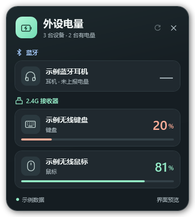

# PeriphGauge · 外设电量

在 Windows 任务栏右下角查看无线键盘、鼠标和耳机的电量。点击托盘图标即可打开面板，设备按「蓝牙」和「2.4G 接收器」分组。



## 下载与使用

1. 下载 [PeriphGauge-win-x64.exe](https://github.com/aliealielie/PeriphGauge/releases/latest/download/PeriphGauge-win-x64.exe)，双击运行。便携版已包含 .NET 运行时，使用普通用户权限即可。
2. 托盘数字显示当前最低的已知电量。鼠标悬停可查看设备与连接方式，点击图标可展开完整面板。如果图标在任务栏的 `^` 菜单里，可以将它拖到时钟旁。
3. 电量每分钟刷新一次，也可以在面板内手动刷新。关闭面板后程序继续在托盘运行，右键托盘图标可退出。

## 桌面悬浮窗与启动选项


打开面板右上角的「更多选项」，或右键点击托盘图标，即可使用以下功能。

- **显示桌面悬浮窗**。收起时，黑色胶囊显示最多两台设备的电量。点击胶囊可查看完整列表与连接方式，再点顶部的箭头收起。拖动胶囊或展开后的顶部可移动，程序会记住位置。展开后可点击关闭按钮隐藏悬浮窗。
- **创建桌面快捷方式**。在当前用户的桌面添加「外设电量」图标，双击即可打开面板。
- **开机自启动**。开启后，登录 Windows 时程序在托盘启动，也会恢复已开启的悬浮窗。默认关闭。

快捷方式指向当前便携版文件。移动 EXE 后，可在新位置重新创建桌面快捷方式，并重新启用自启动。

## 设备兼容性

| 连接方式 | 如何读取电量 |
| --- | --- |
| 蓝牙 | 读取 Windows 提供的电量属性，支持标准 BLE 电量服务。是否显示百分比取决于设备上报。 |
| 2.4G 接收器 | 已实测迈从 A5（`2023:F013`）和 K99 所用的 Compx 接收器（`05AC:024F`）。部分其他接收器可被发现，是否读得到电量取决于其协议。 |

无法取得有效读数时显示「未上报电量」。设备休眠时，可以唤醒后点击刷新。目前提供 Windows 11 x64 便携版。

程序在本机读取设备信息和电量，无联网依赖。

## 从源码构建

在 Windows 上安装 .NET 10 SDK，在仓库目录运行：

```powershell
dotnet run --project PeriphGauge.csproj
dotnet publish PeriphGauge.csproj -c Release -r win-x64 --self-contained -p:PublishSingleFile=true -p:IncludeNativeLibrariesForSelfExtract=true -p:EnableCompressionInSingleFile=true -p:DebugType=none -o release
```

把 `release/PeriphGauge.exe` 改名为 `PeriphGauge-win-x64.exe` 即为发布文件。传入 `--preview` 可打开带示例数据的面板。

使用 `pwsh -File tools/Smoke.ps1` 可检查便携版的设备扫描与报告格式。

## 参考项目与协议

- [Bluetooth Battery Monitor](https://github.com/jeremygold02/bluetooth-battery-monitor) 的托盘交互及蓝牙电量读取思路。
- [A5 Web Driver](https://github.com/z750sasr/mchose-a5-pro-max-web-driver) 和 [mchose-hid-bridge](https://github.com/arutkowski00/mchose-hid-bridge) 的迈从接收器协议资料。

项目使用 [MIT 许可证](LICENSE)。便携版所含运行时的许可声明随发行版提供。
